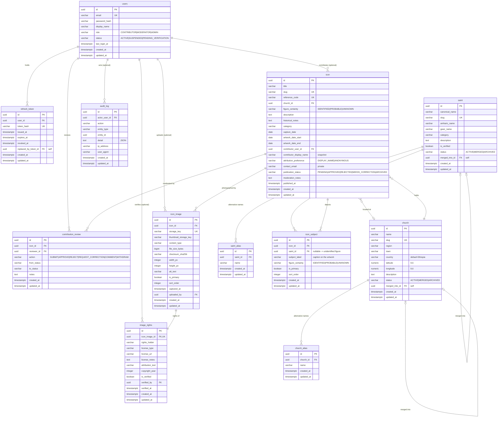

# Database schema

The archive schema is owned by Flyway. Hibernate only validates it
(`spring.jpa.hibernate.ddl-auto=validate`), so any drift between the SQL and
the JPA entities fails fast at startup.

| Profile | Database | Migration set |
|---------|----------|---------------|
| `local` *(default)* | in-memory H2 (`MODE=PostgreSQL`) | `EOTC_ICON-backend/src/main/resources/db/h2` |
| `prod` | PostgreSQL 16 | `EOTC_ICON-backend/src/main/resources/db/migration` |

| Version | `db/migration` (PostgreSQL) | `db/h2` (H2) | Contents |
|---------|------------------------------|--------------|----------|
| V1 | `V1__baseline.sql` | `V1__baseline.sql` | empty baseline (no objects) |
| V2 | `V2__create_core_schema.sql` | `V2__create_core_schema.sql` | all 12 core tables, FKs, indexes, CHECK constraints |
| V3 | `V3__enable_trigram_search.sql` | `V3__enable_trigram_search.sql` *(placeholder)* | `pg_trgm` + GIN trigram indexes (PostgreSQL only) |

The V2 body is byte-identical in both sets; only the header comment differs.
V3 has no H2 equivalent (no `pg_trgm`, no GIN), so the H2 file is a
same-version no-op that documents the skip.

## ERD



## Design decisions

### One icon, many images

`icon` is the aggregate root; `icon_image` holds the photographs
(`1..n`). `storage_key` is unique, `(icon_id, checksum_sha256)` is unique so
the same file cannot be attached twice, and `is_primary` marks the thumbnail
image. Deleting an icon cascades to its images, subjects and reviews.

### An icon can depict an unknown saint

`icon_subject` is the icon↔saint join table. `saint_id` is **nullable** and
`subject_label` keeps the caption that appears on the artwork, so a figure
that could not be identified is still recorded:

| `saint_id` | `figure_certainty` | Meaning |
|------------|--------------------|---------|
| not null | `IDENTIFIED` | the saint is known and certain |
| not null | `PROBABLE` | a saint record exists, identification is not certain |
| null | `UNKNOWN` | unidentified figure — only the caption is known |
| null | `IDENTIFIED` / `PROBABLE` | rejected by `ck_icon_subject_identified` |

Because `saint_id` is nullable it cannot be part of a composite primary key,
so the table uses a surrogate UUID key plus `UNIQUE (icon_id, subject_label)`.
The foreign key to `saint` is `ON DELETE RESTRICT` on purpose: saints are
merged (`merged_into_id`), never deleted, and a cascading `SET NULL` would
silently turn an identified figure into an unidentified one.

### Publication status

`icon.publication_status` is a `VARCHAR` with a CHECK constraint:

```
PENDING ──► APPROVED      (published_at is set)
        ├─► REJECTED
        ├─► NEEDS_CORRECTION
        └─► ARCHIVED
```

* `ck_icon_publication_status` keeps the state machine closed.
* `ck_icon_approved_has_published_at` enforces "approving sets `published_at`".
* Only `APPROVED` records are exposed by the public query services.

`contribution_review.action` mirrors the transitions
(`APPROVE`, `REJECT`, `REQUEST_CORRECTION`, plus `SUBMIT`, `COMMENT`,
`WITHDRAW`) and records `from_status` / `to_status` per decision. Review
rows are append-only.

### Normalization

* `icon.contributor_display_name` and `icon.contact_email` are **intentional
  snapshots**, not foreign keys: an anonymous contribution has no `users` row
  at all, and a registered contributor may change their display name without
  rewriting history. `contributor_user_id` links to the account when there is
  one.
* `icon.figure_certainty` is a roll-up of the primary `icon_subject` row,
  kept for list filtering without a join. The service layer maintains it.
* `icon.capture_date` is the date part of the primary image's
  `captured_at`; `icon_image.captured_at` is the authoritative value.
* Alternative names live in `church_alias` / `saint_alias` instead of
  comma-separated columns, so searching by an alternative name is an indexed
  lookup. `saint.amharic_name` and `saint.geez_name` stay on the row
  because they are 1:1 with the saint.

### Portability (H2 ⇄ PostgreSQL)

The V2 DDL is written to run unchanged on both engines:

| Concern | Decision |
|---------|----------|
| Identifiers | lowercase `snake_case` (H2 runs with `DATABASE_TO_LOWER=TRUE`) |
| Primary keys | `UUID` generated by the application — no DB default, no `gen_random_uuid()` |
| Enumerations | `VARCHAR` + `CHECK`, no native enum types, no lookup tables |
| Timestamps | `TIMESTAMP WITH TIME ZONE` everywhere |
| Numbers | `NUMERIC(9, 6)` for latitude/longitude, `BIGINT` for byte sizes |
| JSON | `TEXT` (`audit_log.detail`) — `JSONB` is PostgreSQL-only |
| Indexes | plain B-tree only; GIN/`pg_trgm` live in the PostgreSQL-only V3 |
| `updated_at` | maintained by the application (`@PreUpdate`), no triggers |
| FK names | explicit, so Hibernate validation can match them |

### Invariants enforced by the database vs. by the service layer

Database-enforced: referential integrity, `UNIQUE` on `slug` /
`reference_code` / `email` / `storage_key` / `token_hash`, CHECK constraints
on every enumeration and on coordinate ranges, `NOT NULL` columns, cascade
and restrict rules.

Service-enforced (not expressible portably): at most one *primary*
`icon_subject` and one *primary* `icon_image` per icon, slug generation and
collision handling, `updated_at` refresh, publication-status transitions, and
`published_at` assignment on approval.

## JPA mapping notes

* `id` → `UUID` with `@GeneratedValue(strategy = GenerationType.UUID)`.
* Timestamps → `Instant` (Hibernate maps it to `timestamp with time zone` on
  both engines).
* `latitude` / `longitude` → `BigDecimal` with
  `@Column(precision = 9, scale = 6)`.
* `icon.contact_email` → `json` DTOs must never serialize it; only
  moderators and the contributor may see it.
* Enum-like `VARCHAR` columns → Java enums with
  `@Enumerated(EnumType.STRING)`; the Java constant names must match the
  CHECK constraint values exactly.

## JPA entities

The entities live in `EOTC_ICON-backend/src/main/java/com/eotcicon/domain/`:
`BaseEntity` (`@MappedSuperclass` with the UUID key and the audit columns) plus
one class per table — `User`, `RefreshToken`, `Church`, `ChurchAlias`,
`Saint`, `SaintAlias`, `Icon`, `IconSubject`, `IconImage`, `ImageRights`,
`ContributionReview`, `AuditLog` — and the enums `UserRole`, `UserStatus`,
`RecordStatus`, `PublicationStatus`, `FigureCertainty`,
`AttributionPreference`, `ReviewAction`, `LicenseType`.

## Tests

* `EOTC_ICON-backend/src/test/java/com/eotcicon/schema/SchemaMigrationTest.java`
  runs the schema contract on the local H2 mirror (it is part of
  `mvn verify`).
* `EOTC_ICON-backend/src/test/java/com/eotcicon/schema/SchemaMigrationPostgresIT.java`
  runs the same contract against PostgreSQL. It is skipped unless
  `EOTC_PG_IT_URL` is set:

  ```bash
  EOTC_PG_IT_URL=jdbc:postgresql://localhost:5432/eotcicon \
    EOTC_PG_IT_USER=postgres EOTC_PG_IT_PASSWORD=postgres \
    ./mvnw test -Dtest=SchemaMigrationPostgresIT
  ```
* `EOTC_ICON-backend/src/test/java/com/eotcicon/domain/EntityMappingTest.java`
  runs the entity contract on the local H2 mirror (it is part of
  `mvn verify`): it persists and reads back the whole icon aggregate, checks
  that the audit columns are stamped and refreshed, and that every enum
  constant is accepted by the matching CHECK constraint.
* `EOTC_ICON-backend/src/test/java/com/eotcicon/domain/EntityMappingPostgresIT.java`
  runs the same entity contract against PostgreSQL and is skipped unless
  `EOTC_PG_IT_URL` is set:

  ```bash
  EOTC_PG_IT_URL=jdbc:postgresql://localhost:5432/eotcicon \
    EOTC_PG_IT_USER=postgres EOTC_PG_IT_PASSWORD=postgres \
    ./mvnw test -Dtest=EntityMappingPostgresIT
  ```
